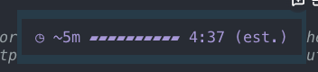

# @nilskluewer/pi-cache-guard

A Pi extension with a prompt-cache countdown and cost warnings. It uses Pi's declared cache lifetime as the countdown baseline and keeps API-reported hits and misses as separate local evidence. Without a declaration for the active retention tier, it uses route-specific starting values and passive learning.



Providers such as Anthropic support a 5-minute prompt cache and an optional 1-hour lifetime. `PI_CACHE_RETENTION=long` asks Pi to request extended retention where supported; it does **not** guarantee a cache hit for an hour, including through GitHub Copilot. See [Cache lifetime and GitHub Copilot](#cache-lifetime-and-github-copilot). If the cache expires or the cached prompt prefix changes, the next message can write a large part of the context to the cache again. On an expensive model, that one message can cost more than a dollar.

This extension:

- shows an estimated countdown with a progress bar above the editor: `◷ ~25m ▰▰▰▰▰▰▱▱▱▱ 14:32 (est.)`. When it ends, the shorter label is `◷ cache est. ended · miss ~$0.18`, not a claim that expiry is confirmed. Corner and editor widgets wrap at the available width. Models without a declared lifetime or a supported local estimate show `cache duration unknown`. Use `/cache-guard` to view mechanics, change placement, or hide the display; see [Placement](#placement).
- automatically prepares one saved handoff near cache expiry when the estimated cold cost of the **current context exceeds $0.50**. This is **on by default**, but pauses while Pi's native idle cache warming is enabled. Generation incurs costs and enters the conversation; it is not a cache refresh. Disable it with `/cache-guard handoff off`; see [Automatic handoff scheduling](#automatic-handoff-scheduling).
- asks before a message goes out after the estimated window ends, if the predicted cache-miss cost exceeds your budget (default $0.10; change it with `/cache-guard budget 0.50`, see [Budget](#budget)):

```text
Prompt cache may need rebuilding (the estimated window ended 2 h ago). On a miss, this message re-sends ~150k tokens: ~$0.94 instead of ~$0.08 with a full cache hit. This is an estimate.
> Continue with Claude Sonnet 5.5 · estimated prompt/cache cost ~$0.94
  Switch to anthropic-vertex/claude-sonnet-5 · ~$0.56
  Switch to anthropic-vertex/claude-haiku-4-5 · ~$0.19
  Cancel (keep text in editor)
```

## Model-specific estimates

**Every countdown is an estimate, not a live provider cache-status check.** A changed prefix can miss while time remains; an unchanged prefix can still hit after the estimate ends. The countdown starts only after reported cache reads or writes establish cache use.

A valid `model.promptCache.short` or `.long` declaration for the active retention tier takes priority over local seeds and learned durations. This includes built-in, extension, and custom models, plus `models.json` overrides. The display marks this baseline `(declared est.)`; it remains best-effort, not a guarantee of reuse. Local evidence can show a different duration without changing the declared baseline.

Without a valid declaration for the active tier, the explicit allowlist below supplies fallback estimates and learning. Other routes show `cache duration unknown`. A declaration does not expand the raw-telemetry learning allowlist.

| Route | Current models | Initial estimate |
|---|---|---|
| GitHub Copilot | Claude Sonnet 5.5, Haiku 5.5 | 5 min short / 60 min long; measured starting values |
| GitHub Copilot | Claude Opus 5.5 | 5 min short / 60 min long; Sonnet-family starting estimate, not an Opus measurement |
| GitHub Copilot | GPT-6.1 Sol | 30 min for the tested configuration |
| GitHub Copilot | GPT-6 Luna | Unknown until enough comparable local observations exist |
| GitHub Copilot | Gemini 3.8 Flash | Variable; no fixed initial countdown |
| GitHub Copilot | Gemini 4 Argon | Conservative 15-min starting estimate; observed hits at 15 min and misses at 18.5 min |
| Anthropic, including its subscription login | Claude Opus 5.5, Sonnet 5.5, Haiku 5.5 | 5 min short / 60 min long; family estimates, independently learned on this route |
| OpenAI Codex subscription or OpenAI API | GPT-6.1 Sol | 30-min family starting estimate, independently learned on each route |
| OpenAI Codex subscription or OpenAI API | GPT-6 Luna | Unknown until enough comparable local observations exist |

Native Anthropic model IDs use `claude-opus-5-5`, `claude-sonnet-5-5`, and `claude-haiku-5-5`; Copilot uses the dotted `5.5` IDs. Native Codex uses the `openai-codex-responses` protocol. Names or protocol aliases outside the allowlist do not silently inherit a fallback timer. They can still use their own declared lifetime.

Prices still come from Pi's `model.cost` catalog and `calculateCost`; Cache Guard maintains no separate price list. Anthropic one-hour write pricing is not applied to OpenAI cache writes.

## Passive local learning

Pi's status-line `CH%` is the latest request's reported cached tokens divided by its total prompt tokens. Cache Guard uses the underlying **raw provider stream events**, not that displayed percentage, elapsed-time guesses, response speed, or cost changes, to classify observations:

- A positive reported cache-read counter is a hit. An explicitly reported zero is a miss. An absent or invalid counter stays unknown.
- Partial reuse remains a hit, but does not prove that the previous whole prefix survived. New uncached conversation content does not reduce the score for the previously cached prefix.
- Only comparable prefixes and settings can train the duration. Prompt/tool changes, failed requests, branch changes, and compaction invalidate the relevant learning anchor. Streaming usage snapshots are not double-counted.
- Three comparable substantial hits in a longer five-minute bucket can extend the local estimate. Three qualifying earlier misses can reduce it. Contradictory shorter misses and longer hits can produce an unknown/variable local duration. **This evidence never extends or shortens a declared lifetime.** It controls the countdown only when the active tier has no declaration.
- Estimates are separate for each provider, API, endpoint, model, retention mode, and relevant request settings. **A Copilot observation cannot change an Anthropic or Codex subscription estimate.** Independent sessions with comparable settings can contribute to the same route's evidence.

Learning sends **no extra requests**, changes no provider payload, and does not enable automatic handoff. Native refresh callbacks do not have a normal assistant-message completion. Cache Guard excludes these refreshes and any overlapping ambiguous sample from duration learning until the next normal turn; their persisted usage still updates accounting and the countdown. The separate automatic-handoff setting remains on by default; use `/cache-guard handoff off` if you want observation without that background generation.

Cache Guard keeps its settings and data together under Pi's configured agent directory: `~/.pi/agent/cache-guard/`, or `$PI_CODING_AGENT_DIR/cache-guard/` when overridden. The installed extension directory contains code only; updates do not replace saved data.

```text
cache-guard/
├─ settings.json
├─ estimates.json
├─ observations.jsonl
├─ observations.jsonl.1
├─ handoffs/
└─ drafts/
```

- `observations.jsonl` and `.jsonl.1`: bounded, rotated numeric observations and salted fingerprints.
- `estimates.json`: private derived estimates and local fingerprint salt.
- `handoffs/`: durable handoff documents. `drafts/`: pending requests and images retained for recovery. These are separate from prompt-free learning telemetry.

Files use private permissions. No prompts, responses, credentials, account names, or workspace paths are logged. File/lock failures do not block a model request. Nothing is uploaded automatically. Learning starts a fresh comparison anchor after reload; derived estimates survive observation-log rotation without retaining live prompt contents.

A crash can leave `cache-guard/observations.lock` behind. If observations stop updating, stop all Pi sessions that use that agent directory before removing the stale lock.

### Automatic migration from older versions

Stop other Pi sessions before the first start with this version. Starting Pi with the updated extension, or running `/reload`, automatically gathers the old root-level `cache-guard.json`, `cache-guard-estimates.json`, `cache-guard-observations.jsonl*`, and `cache-guard-drafts/` into the layout above. Settings, learned estimates, fingerprints, and pending requests are preserved.

The generic old `handoffs/` directory moves only if every entry matches Cache Guard's generated filename and metadata format. A compatibility link at the old location keeps absolute paths in saved sessions usable. Do not remove that link while old sessions still need it. Mixed or unrecognized directories stay untouched; their verified handoffs remain usable.

Migration takes an exclusive `cache-guard/.migration.lock` and never overwrites an existing destination file or directory. If old settings or learning files conflict with current files, the current layout stays authoritative and the incoming legacy files are gathered into a private `cache-guard/legacy/import-*/` backup. Their original bytes and fingerprint salts are preserved; they are not merged into active learning data. Pi shows the backup location on interactive startup. This also handles prefixed files left inside `cache-guard/` by intermediate versions. Conflicting directories, unsafe files, or storage errors still stop Cache Guard with a clear extension-load error. Resolve the cause and restart Pi. Partial moves are safe to retry. If a crash leaves a migration lock or the old `cache-guard-observations.lock`, remove it only after confirming that all Pi processes using that agent directory are stopped. A running old version does not know the new layout and can recreate old files.

## Install

```bash
pi install npm:@nilskluewer/pi-cache-guard
```

Run `/reload` in an existing Pi session.

## Cache lifetime and GitHub Copilot

**`PI_CACHE_RETENTION=long` is a request for extended retention, not a guarantee against cache costs.** For Anthropic Messages, current Pi sends `cache_control: { type: "ephemeral", ttl: "1h" }` unless the model's compatibility settings disable long retention. The provider still controls cache behavior.

To request extended retention for a new Pi process:

```bash
PI_CACHE_RETENTION=long pi
```

For a persistent setting, add `export PI_CACHE_RETENTION=long` to your shell configuration, then start a new shell and restart Pi. Changing the variable in another shell, or in a tool subprocess, does not change an already running Pi process.

### Is GitHub Copilot limited to five minutes?

**Not as a general rule.** GitHub's current [cache guidance](https://docs.github.com/en/enterprise-cloud@latest/copilot/tutorials/optimize-ai-usage#4-preserve-the-cache) says caches expire after inactivity of **24 hours for OpenAI models and 1 hour for most others**. This describes Copilot's products; it is not a guarantee for every third-party client, model, or request through the Copilot gateway.

Pi previously restricted the explicit 1-hour Anthropic TTL to `api.anthropic.com` URLs. With that implementation, `PI_CACHE_RETENTION=long` could silently leave a Copilot or proxy request at the default TTL. Upstream [issue #1377](https://github.com/earendil-works/pi/issues/1377) describes the problem. The fix in [issue #3543](https://github.com/earendil-works/pi/issues/3543) removed the URL gate and added `compat.supportsLongCacheRetention`. The maintainer reported that the long-retention probe passed for GitHub Copilot. Request acceptance alone does not prove that every cached prefix remains reusable for an hour.

### Why can there still be a cache cost before one hour?

A TTL controls how long a cached prefix can remain available. It does not make a changed prefix match. Anthropic's [prompt caching documentation](https://platform.claude.com/docs/en/build-with-claude/prompt-caching) requires an identical prefix through the cache breakpoint. GitHub also warns that model switches and changes to reasoning, context size, or enabled tools can invalidate the cache.

- A model or provider switch cannot reuse the previous model's cache.
- Changes to tools, system instructions, or earlier prompt content can cause a partial or full miss. Compaction rewrites the context too.
- New content after a reusable prefix can incur cache-write costs **even when the earlier prefix is a cache hit**. A write charge alone does not prove that the whole cache expired.
- Older Pi versions, compatibility overrides, or gateway behavior can prevent the requested extended retention from taking effect.

If a cache miss occurs early, check your Pi version, whether the running process received the variable, and whether the model or prompt prefix changed. Compare the request's `cacheRead` and `cacheWrite` usage rather than the countdown alone. Anthropic usage can also include a `cacheWrite1h` count, but a gateway may not expose it. Cache Guard cannot confirm the cause of a specific miss from elapsed time alone.

Anthropic's 1-hour cache writes cost more than 5-minute writes. Cache Guard follows Pi's declared lifetime when available, otherwise it combines model-specific starting estimates with local observations; costs use the catalog and requested retention. Neither value is a provider cache-status check or a billing guarantee. Copilot's tested Sol route behaved around 30 minutes, not 24 hours; current OpenAI cache controls also differ by model generation.

## Native Pi cache warming

Pi's global `cacheWarming` setting is separate from Cache Guard:

| Pi mode | Native behavior | Cache Guard automatic handoff |
|---|---|---|
| `"off"` | No native refreshes | Existing idle handoff policy applies |
| `"streaming"` (Pi default) | Refresh eligible caches during active runs | Existing handoff policy applies after Pi is idle |
| `"idle"` | Can also refresh between runs | **Paused**, even if Pi declines, fails, or stops refreshing |

Native warming requires a declared lifetime for the active retention tier and at least **$0.05 in estimated avoided cache-miss cost**, under Pi's economics and safety limits. `/session` shows Pi's next decision. Its refresh usage counts toward session totals but does not enter model context.

Cache Guard observes `cache_warming_decision` without returning an override. It does not force warming, replace the $0.05 rule, or bypass a safety limit. With native idle warming enabled, Cache Guard does not fall back to a paid handoff after a declined or failed refresh. This prevents a full generation turn from preempting Pi's smaller refresh. The handoff preference stays saved and the settings menu shows why it is paused.

Pi's warming mode is global-only. When the configured agent directory's `settings.json` exists, Cache Guard reads its mode instead of a project's override. Without that file, it uses supplied settings for SDK support; an `idle` value in supplied/merged settings conservatively pauses handoff. Unreadable or invalid warming settings pause automatic handoff as a spending safeguard. Restart or reload after external configuration edits so both components use the same settings. Cache Guard does not change your Pi settings.

Local learned durations do **not** make a model eligible for native warming. To declare a validated route's best-effort lifetime, use `modelOverrides` in `models.json` as described in [Pi's prompt-cache documentation](https://pi.dev/docs/latest/models#prompt-cache-lifetimes). Choose a conservative published lifetime, not a longer observed hit interval.

## Budget

A cold cache costing a few cents is fine for many people. A cold cache costing several dollars is not. The budget is the most a cold-cache send may cost before the extension asks.

```text
/cache-guard budget 0.50   ask only when a cold send costs more than $0.50
/cache-guard budget 0      always ask
/cache-guard budget        pick from a list, or enter your own amount
/cache-guard history       view cache hits, misses, tokens & costs across all Pi sessions
/cache-guard               one settings menu: info, history, budget, handoff toggle/threshold, countdown placement
```

Amounts are in US dollars, because Pi's model prices are in US dollars. The default is $0.10. A saved budget replaces the `PI_CACHE_GUARD_MIN_USD` environment variable, which stays as a fallback default.

## Automatic handoff scheduling

Automatic handoff is **on by default**, with a **$0.50 estimated current-context cold prompt/cache cost threshold**. It can spend money on one visible handoff turn per session. **Native `cacheWarming: "idle"` pauses this generation**, even when the saved handoff preference is on. A saved explicit on/off choice is retained:

```text
/cache-guard handoff on                enable automatic generation (default)
/cache-guard handoff off               disable automatic generation
/cache-guard handoff threshold 0.50    require estimated current-context cold cost > $0.50 (default)
/cache-guard handoff                   open the same settings menu
```

The threshold accepts finite, nonnegative USD amounts. It is separate from the cold-send warning budget. The estimate uses the current context size, current model prices, and retention setting, with the same calculation as the cold-cache dialog. It is not lifetime spending or the estimated cost of generation. A $0.50 estimate does not trigger; an estimate above $0.50 does. A small context after compaction does not qualify just because the earlier session was expensive.

The new threshold is saved as `handoffColdCostThresholdUsd`. The legacy `handoffThresholdUsd` measured lifetime spending and is ignored, not reinterpreted: an old configuration uses the new $0.50 default unless a new threshold is saved. Saved `autoHandoff: false` remains off; budget and placement are preserved. Malformed or unreadable settings disable automatic generation rather than allow unattended spending.

In an interactive terminal session, the extension checks once per second. When native idle warming is not enabled, it starts at the first eligible check with **more than zero and at most 60 seconds** of estimated cache lifetime left, only when Pi is idle and has no pending messages. It uses the current model, the normal tools, and the original handoff prompt. It does not compact, change models, or switch sessions. The generated document is verified and copied to an agent-owned `handoffs` directory outside the workspace, with source-session metadata.

Generation, output, and tool follow-up requests still incur costs. The 60-second lead does not guarantee a warm-cache hit or completion before expiry. If Pi is busy through the estimated window, closed, or asleep past that window, there is **no automatic catch-up**. Hiding the countdown with `/cache-guard off` does not disable enabled scheduling.

While the handoff runs, the working label says **Preparing handoff…**. The label is retained through continuations and resets when the run completes or fails. Pi can temporarily show its own retry indicator during retry delays. After the durable file and ready metadata are saved, a notice says: **A handoff was created while you were away.** Send a message to continue; when the cold-cache dialog appears, select **New session with saved handoff** to use it. The dialog still requires an ended estimated cache window and an estimated send cost above your budget. Unknown or variable durations do not authorize an expiry-based dialog or automatic handoff. Pi's extension API cannot hide the complete generation turn; its prompt, tool calls, and responses still appear in the source session. Pi's default Ctrl+O shortcut folds tool output, and Ctrl+T toggles thinking visibility. Cache Guard does not change these global display preferences.

There is at most one automatic dispatch attempt per session, including failed attempts. The guard survives cache refreshes, further work, branch changes, reloads, and resumes. Failures are reported without an automatic retry. The enabled flag and threshold are saved with the budget and placement in `~/.pi/agent/cache-guard/settings.json`.

## Placement

The countdown is shown above the editor by default: `◷ ~5m ▰▰▰▰▰▰▰▰▰▱ 4:10 (est.)`. The bar uses Pi's accent colour and turns to the warning colour in the last minute. The corner box and above/below widgets use one line when it fits and wrap when the terminal narrows. They keep the miss cost or countdown visible. Very narrow layouts use shorter labels and can omit the progress bar, not the countdown.

```text
Wide:    ▌ ◷ cache est. ended · miss ~$0.18 ▐

Narrow:  ▌ ◷ cache est. ended ▐
         ▌ On a miss: ~$0.18  ▐
```

The footer remains one compact line without optional hit history; Pi controls its available space, so other extensions can still hide it. Change the place with:

```text
/cache-guard            pick from a list
/cache-guard above      above the editor (default)
/cache-guard corner     top right corner, as a boxed overlay
/cache-guard below      below the editor
/cache-guard footer     footer status line
/cache-guard off        hidden
```

`/cache-guard` opens one flat settings menu:

- **ℹ Info**: explains how the prompt cache countdown, hits, misses, and model differences are calculated.
- **◷ History**: opens an aligned cross-session report of cache hits, writes, misses, token counts, and catalog-calculated USD costs over the last 30 days (also available directly via `/cache-guard history [filter]`).
- **Cold-send budget**: edits the warning threshold before cold sends.
- **Automatic handoff**: toggles the saved on/off preference and shows when native idle warming pauses generation.
- **Handoff threshold**: edits the USD threshold for automatic handoff preparation.
- **Placements (`above`, `below`, `corner`, `footer`, `off`)**: direct placement selection without submenus.

Selecting a setting applies it directly; Escape cancels. `/cache-guard handoff` without arguments opens that same menu.

Settings are saved in `~/.pi/agent/cache-guard/settings.json`.

## Configuration

| Environment variable | Default | Effect |
|---|---|---|
| `PI_CACHE_GUARD_MIN_USD` | `0.1` | Default budget: ask only when a cold send costs more than this amount. `0` always asks. A budget set with `/cache-guard budget` takes priority. |
| `PI_CACHE_RETENTION` | – | Pi's own setting. `long` requests extended retention where supported; it does not guarantee a cache hit. Countdown and cost estimates follow this request. See [Cache lifetime and GitHub Copilot](#cache-lifetime-and-github-copilot). |

## Behavior

- The estimated window ends at `last reported cache use + declared lifetime`, or the fallback local estimate when the active tier has no declaration. Normal assistant requests use request-start time, so generation time counts against the estimate. Native `cache_warm` usage entries use Pi's persisted refresh timestamp, in line with its next refresh schedule. Entries without reported cache reads/writes do not prove reuse.
- A model change cannot assume reuse of the previous model's prefix. Unknown routes stay unknown.
- Compaction resets the prefix and learning comparison. Without a known estimate and cache-use anchor, the extension does not ask or start an expiry-based handoff.
- Only interactive input is checked. Slash commands and `!` shell commands are ignored; prompt templates and skills are checked.
- The dialog shows every model in the session's `/scoped-models`, in scope order, including equal-price, higher-price, and cross-provider models. The current model is represented by Continue. Each model shows its estimated cold prompt/cache cost. Models that cannot fit the context remain visible with `(context too large for model: …)`; selecting one explains the limit and reopens the dialog without switching or sending. There is no catalog fallback. The scoped thinking level is applied on switching. If no models are scoped, Continue and Cancel are offered, plus the saved-handoff choice when available.

## Continue with a saved handoff

When automatic handoff has saved a verified document, the existing expensive cold-cache dialog also offers:

```text
> New session with saved handoff · 2026-01-02T03:04:05.000Z
  Continue with Claude Opus 4.8 · estimated prompt/cache cost ~$0.94
  Switch to anthropic-vertex/claude-sonnet-5 · ~$0.56
  Cancel (keep text in editor)
```

- **New session** starts a linked, fresh session with the saved document and your pending text and images. It does not copy the old history or compact it. Prompt templates and skills still expand for the pending request.
- **Continue** keeps the full old conversation. The estimate covers prompt input/cache cost, not the complete next turn or guaranteed savings. All scoped models remain visible with estimated costs and context-fit reasons; their thinking levels are applied on switching.
- The creation time is shown. Later task work or a different conversation branch adds an **older state** warning. The handoff's own generation and extension metadata do not make it older. No new document is generated by this choice.
- Missing or changed files are not offered. The file is checked again before session replacement.
- Cancel or a failed transition keeps the pending request. Pi has no extension API to restore image attachments to the editor, so Cache Guard retains images for the next model-bound input, including edited text. Shell and slash commands do not consume that draft.

Recovery drafts contain your pending text and images. They are stored locally under `~/.pi/agent/cache-guard/drafts/` (or `<configured agent directory>/cache-guard/drafts/`), outside the workspace, with private file permissions where supported. They survive reload and session resume and are removed when consumed. Do not share these files without review. If saving fails, Cache Guard refuses the session replacement and retains the draft in memory; keep Pi open.

Pi's runtime invalidates the old context during replacement. If sending fails after a linked replacement, Cache Guard uses the fresh command context to return to the source session. A file-less source has no resumable parent: its request and handoff stay as a draft in the new session. If Pi itself fails while creating the replacement runtime, reopen the source session to recover the saved request and images. No automatic retry occurs.

Requires Pi **1.3.0 or newer** for the raw `provider_stream_event` integration. The offline real-runtime tests use installed Pi **1.4.0**, including its real cache warmer and native Anthropic and Codex protocol events. `/cache-guard-resume` is an internal, single-use command bridge, not a command to generate handoffs.

## Test

```bash
npm test
```

### Native warming verification

`tests/cache-warming-pi.test.mjs` runs real Pi SDK sessions and its native warmer, with only the provider network boundary replaced. It checks declared-tier precedence, custom models, native warm/stop decisions, usage totals without context changes, global settings precedence, and handoff suppression through refresh failures and Pi's idle safety limit.

For an opt-in live-provider check with isolated settings and synthetic prompts:

```bash
PI_PROVIDER=github-copilot PI_MODEL=gpt-6.1-sol \
  node --experimental-strip-types scripts/verify-native-warming.mjs --paid
```

This sends at most four requests with a $0.25 conservative catalog-cost reserve. It verifies Pi's native cost-based stop and one actual refresh using a **probe-only** decision override. The override avoids sending a large paid prompt merely to cross the native savings threshold; the offline runtime test covers an unforced warm decision. A conservative 30-second declared lifetime accelerates scheduling, not provider expiry. The script checks real cache-read usage, unchanged model context, session accounting, and no competing handoff with its threshold set to zero. It writes a local summary to `.scratch/native-warming-live.json` and prints the isolated session paths. It does not modify normal Pi settings or install the checkout.

### Two-day local observation before publication

To activate a local checkout, run this command from its root:

```bash
pi install "$PWD"
```

If Pi already loads that checkout through a link in `~/.pi/agent/extensions/`, skip the installation. Run `/reload` in each open Pi session to load the latest code.

Use the local checkout for normal work for the next two days; publishing is a separate manual action. To prevent automatic handoff spending during observation, run `/cache-guard handoff off`. Normal user requests are enough to collect evidence; synthetic probes are not required.

Before publishing new starting values, review the local observations per route, discard incomparable or conflicting samples, and update only justified model estimates. Publish aggregate estimates and their uncertainty, never raw local logs or the private fingerprint salt. This package does not schedule an automatic publish or upload user telemetry.

## Contributors

Thanks to [@paulrohde675](https://github.com/paulrohde675) for contributing to this project.

## Patch notes

See [PATCH_NOTES.md](./PATCH_NOTES.md) for the full release history.

### `0.6.1` (2026-10-31)

- **Changed**: The countdown uses Pi's declared `promptCache` lifetime as its baseline. Automatic handoff pauses while Pi's native idle cache warming is on. Settings and data are grouped under `<agentDir>/cache-guard/`.

### `0.6.0` (2026-10-27)

- **Added**: Cross-session cache history viewer (`/cache-guard history [filter]` and `◷ History` in `/cache-guard`) with aligned columns and repeated/bottom headers so column names stay visible.
- **Added**: Implicit/zero-cost cache-write anchoring for routes that omit `cache_write_tokens` (such as Gemini 4 Argon) plus automatic 30-day observation pruning.
- **Changed**: Hit-supported 5-minute buckets tolerate isolated opportunistic early misses and surface observed read-hit horizons and uncertainty (`hits ≤...`, `early misses`, `writes $0/unreported`) instead of collapsing into a bare `cache duration variable` label.

### `0.5.2` (2026-10-26)

- **Added**: Package preview screenshot (`assets/cache-guard-preview.png`), `pi.image` gallery preview, and `PATCH_NOTES.md` release history.

### `0.5.1` (2026-10-26)

- **Added**: `ℹ Info · How cache & learning are calculated` in `/cache-guard` to explain countdown math, route differences, hit rules, raw `provider_stream_event` inspection, and Pi harness hooks.
- **Changed**: Compact countdown format `◷ ~5m ▰▰▰▰▰▰▰▰▰▱ 4:10 (est.)` (removed `last hit after Xmin`).

### `0.5.0` (2026-10-23)

- **Added**: Passive local cache-duration learning from raw `provider_stream_event` usage counters and salted prefix fingerprints (with [@paulrohde675](https://github.com/paulrohde675)).
- **Added**: Model- and route-specific initial cache estimates for GitHub Copilot, Anthropic, and OpenAI / Codex subscription routes.
- **Added**: Responsive width-aware countdown and cold-cache widgets (`extensions/cache-display.ts`).
- **Changed**: Expired-window label updated to `◷ cache est. ended · miss ~$0.18`; requires `@earendil-works/pi-coding-agent >= 1.3.0`.

### `0.4.0` (2026-10-13)

- **Added**: Automatic session handoff scheduling near cache expiry when estimated cold context cost exceeds `$0.50` (`/cache-guard handoff on|off|threshold <usd>`).
- **Added**: **New session with saved handoff** choice in the cold-cache dialog with crash-safe local draft recovery for text and images.
- **Changed**: Cold-cache dialog lists all `/scoped-models` in scope order with estimated cold costs and context-fit status.

### `0.3.1` (2026-10-08)

- **Fixed**: Imported `calculateCost` from `@earendil-works/pi-ai` package root for Pi runtime module mapping compatibility.

### `0.3.0` (2026-10-08)

- **Added**: Configurable cold-cache cost budget via `/cache-guard budget [usd]` and the `/cache-guard` settings menu, persisted in `~/.pi/agent/cache-guard.json`.

### `0.2.0` (2026-10-08)

- **Added**: Visual countdown progress bar (`▰▰▰▰▰▰▱▱▱▱`) with last-minute warning colour and top-right boxed overlay placement (`/cache-guard corner`).
- **Changed**: Cold-cache indicator uses Pi's `error` theme colour; `above` editor is default placement.

### `0.1.0` (2026-10-08)

- **Added**: Initial release with prompt-cache countdown, cold-cache cost guard dialog, `/scoped-models` switching, and protocol TTL fallbacks.

## License

MIT
